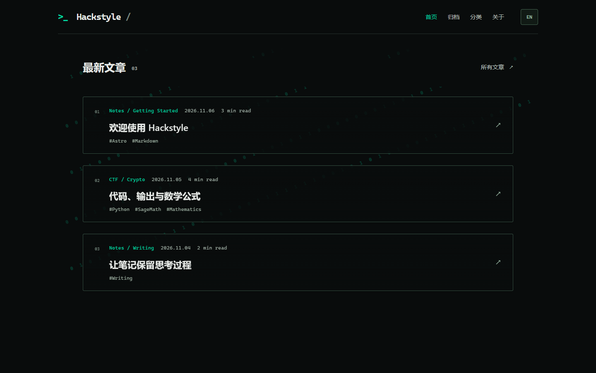
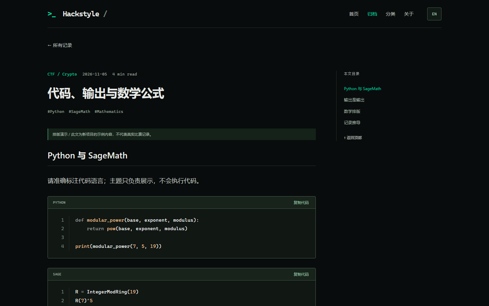
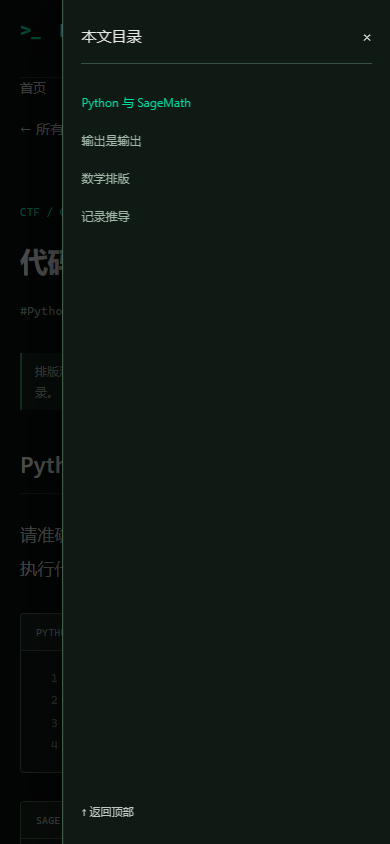

# Hackstyle

[](https://github.com/rekjorekjo/hackstyle/actions/workflows/ci.yml)
[](LICENSE)

**Hacker × Minimalism × Academic.** 一个面向技术笔记、代码分析、CTF Writeup 和数学推导的 Astro 博客主题与起步项目。

Hackstyle 以静态页面、阅读体验和简单配置为核心。它是可以直接克隆、修改和构建的 Astro starter，不是需要额外安装的 Astro integration，也不依赖后台服务。



## 特性

- **静态 Markdown 内容**：Astro Content Collections 与 Zod 校验，按日期倒序展示，支持草稿和明确标注的演示文章。
- **分类与标签**：多级分类树、时间归档、安全的标签标识符，页面在构建时生成。
- **长文阅读**：桌面侧栏目录、章节高亮与自动定位；手机端 48px 图标按钮打开目录抽屉，支持键盘、Escape、遮罩关闭和焦点返回。
- **代码与公式**：Shiki `vesper` 语法高亮、代码复制、行号与横向滚动；KaTeX 行内及块级公式。SageMath 按 Python 语法着色，输出与日志保持中性颜色。
- **图片放大**：文章图片支持大图查看、原始尺寸、适应窗口及键盘关闭。
- **界面双语**：EN / 中 切换操作标签并保存偏好；文章标题、正文、分类名称及用户资料保留原语言。
- **Binary Flow**：首页斜向二进制底纹，桌面五条、手机四条轨迹。位置与连续运动由 CSS 提供，JavaScript 增强亮度变化；脚本加载失败仍可见，离屏暂停，尊重减少动态效果偏好。文章页不添加动画。
- **可选资料**：头像、ID、签名、标签、联系方式与博客介绍可配置。空字段不会生成占位文字，摘要默认隐藏但仍可用于 SEO。
- **可移植部署**：支持站点根路径和项目子路径，CI 同时验证两种情况。

| 桌面侧栏阅读 | 手机目录抽屉 |
| --- | --- |
|  |  |

## 开始使用

推荐 **Node.js 24** 和 npm；最低版本为 `22.23.4`。

```bash
git clone https://github.com/rekjorekjo/hackstyle.git my-blog
cd my-blog
npm ci
npm run dev
```

访问 `http://127.0.0.1:4321/`。仓库只包含原创演示文章及示意图，不包含作者个人博客文章、头像、图片和历史迁移数据。可以先体验主题，再替换演示内容。

| 命令 | 用途 |
| --- | --- |
| `npm run dev` | 启动本地开发服务器 |
| `npm run check` | Astro / TypeScript 检查 |
| `npm test` | 完整回归：根路径、子路径、草稿、分类、界面语言、目录及代码复制等 |
| `npm run build` | 构建静态站点到 `dist/` |
| `npm run preview` | 预览已构建的网站 |
| `npm run audit` | 对构建产物检查路由、图片、内部链接、公式和手机布局 |
| `npm run verify` | 验证运行中的站点，默认端口 4321 |
| `npm run verify:binary` | 二进制轨迹、运动、透光、减少动态效果及 CSS 回退专项检查 |

浏览器验证使用 Chrome。运行前安装：

```bash
npx playwright install chrome
# Linux CI 环境可使用 npx playwright install --with-deps chrome
```

`verify` 和 `verify:binary` 需要已启动的开发或预览服务器，可以用 `PREVIEW_URL` 指定完整地址。检查截图与报告写入 `.artifacts/`，临时回归项目写入 `.work/`，两者均不提交。

## 配置自己的站点

编辑 `src/config.ts`：

```ts
export const site = {
  name: 'Your Name',
  title: 'Your Name / field notes',
  description: 'Your site description.',
};
```

站点品牌与页面标题跟随这些值，不需要逐页替换。`postDisplay.showDescriptions` 默认 `false`；需要卡片和文章标题区显示摘要时设为 `true`。

`author` 中的头像、ID、签名、简介和个人标签可以单独填写。`showContacts: true` 才展示已填写的联系方式；`showBlogInfo: true` 才展示 `blogParagraphs`。头像留空时使用字母头像；本地头像放入 `public/` 后填写对应路径，例如 `/images/avatar.jpg`。

界面标签位于 `src/lib/i18n.ts`。当前是界面文字切换，没有 `/en/` 文章副本或自动翻译服务。

## 写文章

在 `src/content/posts/` 添加 Markdown 文件：

```yaml
---
title: "RSA：从基础到实践"
date: 2026-11-06
categories: [CTF, Crypto]
tags: [RSA, Python]
minutes: 12
description: "可选的文章摘要。"
draft: false
demo: false
---
```

- `title`、`date`、`tags`、`minutes` 必填，`description` 可省略。缺少摘要时 SEO 描述回退到站点说明。
- `categories: [CTF, Crypto]` 表示从属路径 **CTF → Crypto**；多个分支可写成 `[[CTF, Crypto], [Notes, Security]]`。旧式 `category: CTF` 也支持。
- `draft: true` 只在开发环境预览，不进入生产文章、列表或分类。
- `demo: true` 仅添加演示标记，**不会阻止发布**。删除或替换仓库中的演示文章后再发布自己的内容。
- 文件名决定文章 ID，发表后保持稳定。日期显示及归档按 `Asia/Shanghai`；如需其他时区，修改 `src/lib/dates.ts`。
- H2 / H3 标题生成目录；代码内容不会被执行。

代码围栏准确标注 `python`、`bash`、`cpp`、`javascript`、`sage` 等；输出、日志或密文使用 `text`、`plaintext`、`output` 或 `log`。公式使用 `$...$` 与独立行的 `$$...$$`。

为便于子路径部署，文章配图优先放在 `src/assets/` 并使用相对引用。演示文章提供了可用示例：

```md

```

Astro 会生成适配部署路径的资源 URL。直接写 `/images/...` 的 Markdown 链接不会自动变成 `/仓库名/images/...`，使用 `public/` 资源时请自行核对路径。

## 构建与部署

这是静态站点，可将 `dist/` 部署到任意静态托管服务。**本项目仓库只配置 CI，不会自动发布演示站，也不会向作者主站部署。**

通过进程环境配置部署地址，不修改页面源码：

```bash
# 独立域名或 GitHub 用户主页
SITE_URL=https://username.github.io BASE_PATH=/ npm run build

# GitHub Pages 项目仓库
SITE_URL=https://username.github.io BASE_PATH=/my-blog/ npm run build
```

PowerShell：

```powershell
$env:SITE_URL='https://username.github.io'
$env:BASE_PATH='/my-blog/'
npm run build
npm run audit
```

`SITE_URL` 只填写 origin，仓库路径放在 `BASE_PATH`。项目不自动从 `.env` 读取这两个部署参数；请使用 shell 或 CI 注入。未配置 `SITE_URL` 时本地构建省略 canonical。修改地址或路径后需要重新构建。

要使用 GitHub Pages，可以在自己的仓库启用 Pages 并自行添加 Actions 发布步骤；本仓库的 `ci.yml` 只有只读检查权限，没有 Pages 发布权限。发布前运行 `npm run check`、`npm test`、`npm run build`、`npm run audit`，并确认自己的资源和文章路径完整。

## 目录结构

```text
.github/workflows/ci.yml  只读 CI；不部署
public/                  原样复制的站点资源
src/assets/demo/         原创演示示意图
src/content/posts/       演示文章及你的 Markdown
src/components/          文章列表、Binary Flow
src/layouts/             公共布局
src/lib/                 日期、路径、内容查询、分类和界面标签
src/pages/               静态页面与路由
src/scripts/             浏览器交互
src/styles/              主题与响应式样式
scripts/                 回归、构建审计和浏览器验证
tests/fixtures/          合成测试文章，不作为公开博客内容
```

## 贡献与许可

欢迎问题反馈与改进。提交前请阅读 [CONTRIBUTING.md](CONTRIBUTING.md)。版本变化记录在 [CHANGELOG.md](CHANGELOG.md)。

[MIT License](LICENSE) © 2026 rekjorekjo。演示文章与示意图随本项目提供；第三方依赖遵循各自许可证。本仓库没有打包第三方字体或个人博客资源。

---

Hackstyle is a minimal Astro starter for technical writing, code and mathematics. Clone it, personalize `src/config.ts`, replace the original demo posts, and build a static site. Interface labels support Chinese and English; article content is never automatically translated. This repository publishes source code and runs CI only.
