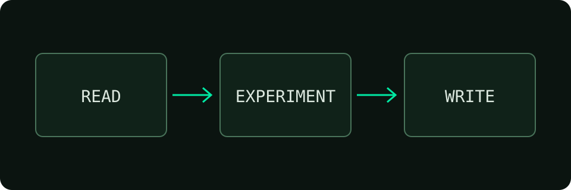

## 阅读优先

这是一篇主题演示，不是原博客文章。Hackstyle 使用静态 Markdown、层级分类与标签，让技术写作保持简单。



## 从这里开始

```bash
npm ci
npm run dev
```

在 `src/config.ts` 修改站点名称；在 `src/content/posts/` 添加自己的文章。摘要、联系方式和博客说明默认关闭，按需要开启。

## 手机与键盘

手机文章页右下角的图标可打开目录。支持选择章节、遮罩关闭、Escape 和键盘焦点返回。图片也可以点击放大。

## 界面语言

右上角的 EN / 中 切换导航与操作标签，并保留选择。文章标题、正文和作者自定义字段不会自动翻译。
